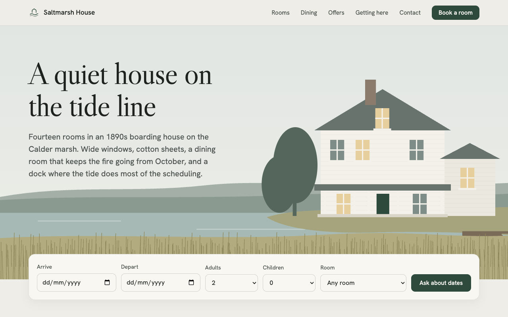

# Saltmarsh House: Astro hotel website template

A boutique hotel website with rooms and galleries, a booking widget that links to your booking engine, dining, directions and offers. Static, fast, and no server needed.



[](https://console.cloudzyro.com/new?repo=https://github.com/Cloudzyro/template-hotel)

## What's included

- Home page with a drawn scene of the house, a booking widget, arrival details, rooms, dining hours, a map and offers
- Rooms page and a page for every room, with a picture gallery (previous and next buttons, thumbnails and arrow keys), size, beds, sleeps, view, amenities and the rate
- A booking widget (arrive, depart, adults, children, room) that sends guests to your booking engine with their choices as query parameters, or to the inquiry form when no booking engine is set
- Dining page with hours and menus, offers page with codes, and a getting here page with a drawn map, directions by car, train, air and boat, and what's nearby
- Contact page with an inquiry form that posts to a form service of your choice and picks up the dates a guest chose in the booking widget
- Hotel structured data (schema.org), Open Graph tags, sitemap, robots.txt, favicon and a 404 page
- Responsive down to 360px, keyboard friendly, reduced motion respected
- Room and house pictures are SVG drawn in code, so there are no photos to license

## Run it locally

```bash
pnpm install
pnpm dev        # http://localhost:4321
pnpm build      # static site in dist/
pnpm preview
```

## Make it yours

- **Content:** everything is in `src/data/site.ts`: the hotel's name, address, phone, check-in times, menu, rooms, dining hours and menus, directions, nearby places and offers. Add a room to the `rooms` list and its page, card and booking option appear by themselves.
- **Booking engine:** set `PUBLIC_BOOKING_URL` to your booking engine's address (Cloudbeds, Mews, SiteMinder, Little Hotelier or similar), or put it in `bookingUrl` in `src/data/site.ts`. The widget adds the guest's choices as query parameters named in `bookingParams` (by default `arrive`, `depart`, `adults`, `children` and `room`, with the room's slug as its value), so rename them to match what your booking engine expects. With no URL set, the button says "Ask about dates" and takes guests to the contact page with their dates filled in.
- **Inquiry form:** set `PUBLIC_FORM_ENDPOINT` to a form endpoint from Formspree, Basin, a Supabase function or similar. The form sends `name`, `email`, `topic`, `arrive`, `depart`, `adults`, `children`, `room` and `message` as form data. With no endpoint set, the form shows a short note and opens the guest's email app addressed to the email in `src/data/site.ts`.
- **Site address:** set `SITE_URL` (for example `https://www.saltmarshhouse.com`) so the sitemap, canonical links and social previews use your domain.
- **Colors and fonts:** colors are CSS variables at the top of `src/styles/global.css`. Fonts are Libre Caslon Display for large headlines and Hanken Grotesk for everything else, self-hosted with Fontsource and imported in `src/layouts/Base.astro`.
- **Pictures:** each room has a `palette` (wall, floor, linen, throw, wood) and a `gallery` of drawn views (`bed`, `window`, `bath`, `desk`, `porch`), drawn by `src/lib/scenes.ts`. To use photos instead, replace `src/components/RoomScene.astro` with an `` and put your files in `public/`.
- **Social preview image:** replace `public/og.png` (1200 x 630).

Environment variables are read at build time. Locally, put them in `.env`:

```bash
PUBLIC_BOOKING_URL=https://booking.example.com/saltmarsh-house
PUBLIC_FORM_ENDPOINT=https://formspree.io/f/your-id
SITE_URL=https://www.saltmarshhouse.com
```

## Deploy

Click the Deploy button above, or push your own copy to GitHub and connect it in the Cloudzyro console. Add the environment variables in your site's settings. The build command is `pnpm build` and the output folder is `dist/`, a plain static site.

## Stack

- Astro 7 (static output)
- @astrojs/sitemap
- Fontsource (Libre Caslon Display, Hanken Grotesk)
- TypeScript, plain CSS

MIT licensed. See [LICENSE](./LICENSE).
